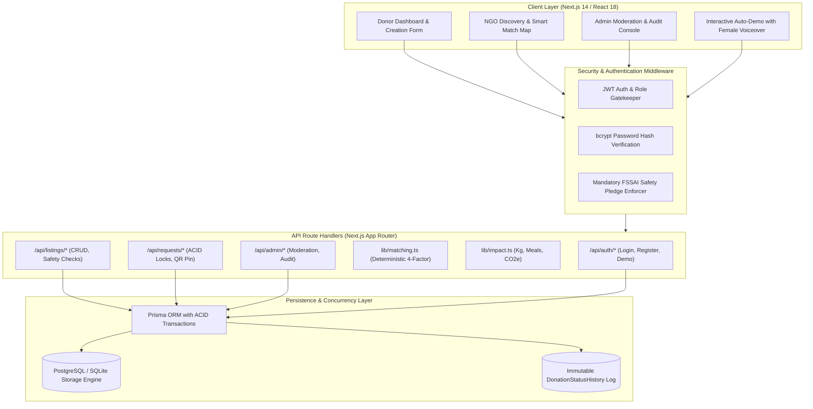
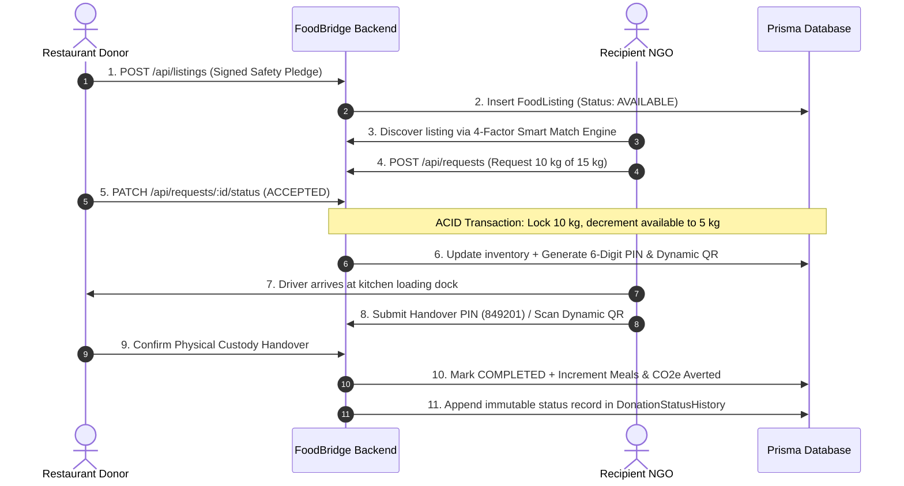

# 🏗️ FoodBridge — System Architecture Diagram & Technical Design

**Problem Statement:** HACK-P197 (Food Donation & Redistribution Platform)  
**System Name:** FoodBridge  
**Architecture Pattern:** Clean Layered App Router Architecture (Client Layer, Service/Route Layer, ORM Layer, Database Layer)

---

## 🏛️ High-Level System Architecture Flow

---

## 🔄 End-to-End Concurrency & Verification Lifecycle

---

## 🛡️ Key Architectural Guarantees
1. **Zero Double-Booking Guarantee:** All quantity reservations execute inside `prisma.$transaction()` isolation blocks.
2. **Food Safety Gate:** Listings without an explicit `donorDeclarationAccepted: true` flag are rejected at the schema validation boundary.
3. **Auditable Custody Chain:** Every state transition permanently records the timestamp, actor ID, actor role, and previous/new status in the database.
