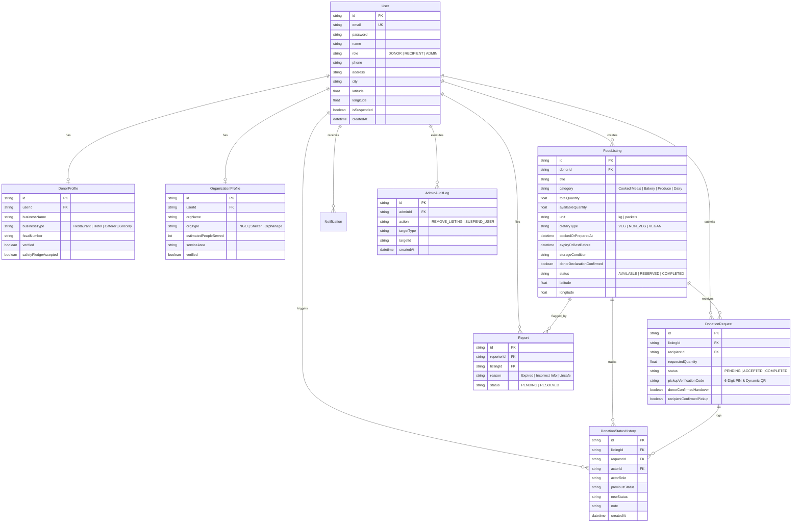

# 🗄️ FoodBridge — Database Design & Entity Relationship Diagram (ERD)

**Problem Statement:** HACK-P197 (Food Donation & Redistribution Platform)  
**ORM:** Prisma ORM 5.22.0  
**Supported Databases:** PostgreSQL (Production) / SQLite (`dev.db` for zero-friction local and edge evaluation)

---

## 📊 Entity Relationship Diagram (Mermaid ERD)

---

## 🔐 Key Data Integrity Features
1. **Cascade Deletions & Referential Integrity:** Cascade constraints safeguard relational consistency across profiles, notifications, and transactions.
2. **ACID Transaction Safeguards:** Quantity locks and dual-party confirmation states operate under Prisma atomic transactions.
3. **Audit Immutability:** `DonationStatusHistory` records are append-only to preserve a verifiable chain of custody for food safety audits.
